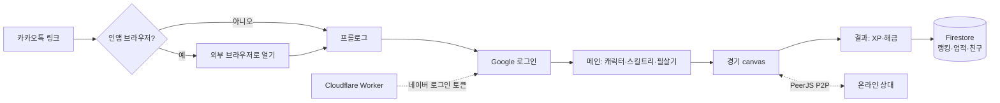

# SPP — Snap Ping Pong

탁구 동호회 사람들을 캐릭터로 만든, 드래그로 스윙하는 모바일 탁구 웹게임.

**▶ [바로 플레이](https://playspp.site/)** · [Android APK](https://github.com/hooni9807/spp/releases/download/android-latest/SPP.apk)

> 2026-10-12 ~ 2026-11-17 · 커밋 1,567개 · 1인 개발 (AI 페어 프로그래밍)

---

## 1. 왜 만들었나

- **문제**: 동호회 단톡방에서 오가던 농담과 캐릭터(누구는 커트만 친다, 누구는 술 마시면 강해진다)를 실제로 같이 즐길 거리가 없었다.
- **목적**: 카카오톡 링크 하나로 바로 열리는 탁구 게임. 휴대폰에서 짧고 손맛 있는 랠리를 치고, 레벨·해금·랭킹으로 회원끼리 계속 겨루게 만든다.
- **대상**: 동호회 회원(주 사용자), 링크를 받은 처음 보는 사람. 대부분 **휴대폰 + 카카오톡 인앱 브라우저**로 접속한다.

### 처음에 정한 원칙

([PRODUCT.md](PRODUCT.md)에 기록)

1. 휴대폰 우선: 경기 중 엄지 하나로 모든 걸 누르고 읽을 수 있어야 한다.
2. 랠리가 주인공: 어떤 UI도 스윙을 가리지 않는다.
3. 회원들이 자기와 서로를 알아볼 수 있어야 한다. 실제 회원 얼굴 사진을 동의받고 사용했다.
4. 성장은 노력해서 얻은 느낌이 나고 눈에 보여야 한다.

### 제약

- 서버 없이 GitHub Pages 정적 호스팅만 쓰고, 빌드 단계도 두지 않는다.
- Firebase는 무료(Spark) 요금제 안에서만 쓴다.
- 다른 게임의 그림이나 애니 캐릭터를 쓰지 않는다.

## 2. 설계



| 결정 | 이유 |
|---|---|
| 단일 `index.html`에 canvas 렌더링, 빌드 없음 | 링크만 열면 바로 실행되고, push하면 곧바로 배포된다. 이 규모에서는 번들러 관리 비용이 더 크다. |
| Firebase Auth + Firestore | 서버 없이 로그인과 랭킹을 붙일 수 있고 무료 요금제 안에서 끝난다. |
| 점수 검증은 Firestore 규칙으로 | 무료 요금제에서는 Cloud Functions를 쓸 수 없다. 그래서 규칙 안에서 형식과 증가 폭 상한을 검사한다. |
| 온라인 대전은 PeerJS(P2P) | 실시간 서버 없이 방장이 상태를 정하는(host-authoritative) 구조로 1:1과 3인 대전을 구현했다. |
| Android는 Capacitor로 감싸기 | 웹 코드를 그대로 재사용하고 GitHub Actions에서 서명된 APK·AAB를 만든다. |

## 3. 개발 과정

커밋 기록으로 정리한 단계입니다. 버전별 세부 내용은 [패치노트](docs/patch-notes.md)에 있습니다.

| 단계 | 기간 | 한 일 |
|---|---|---|
| **0. 프로토타입** | 10-12 | `SPIN LAB`이라는 이름으로 탁구 랠리 프로토타입 첫 커밋 |
| **1. 핵심 조작** | 10-13 ~ 10-15 | 라켓·러버 선택, 포핸드/백핸드 스윙 모션, 타이밍 판정(PERFECT·GREAT·GOOD). 카카오톡 인앱 브라우저용 화면 고정. Firestore 랭킹 규칙 첫 작성 |
| **2. 손맛 튜닝** | 10-14 ~ 10-15 | 네온 테마와 경기장 배경을 넣음. 카메라·타이밍을 여러 번 바꿔 보다가 v2.02로 롤백(아래 트러블슈팅 3) |
| **3. 캐릭터와 서브** | 10-17 ~ 10-19 | 실제 회원 캐릭터 추가(캐릭터마다 특성과 PERFECT 대사). 커트 서브 투바운드 규칙, 빠른 매칭 방, 친구·채팅(PeerJS) |
| **4. 모드 확장** | 10-19 ~ 10-22 | AI 울트라 난이도, 3인 대전(육각 테이블, Y자 네트), 온라인 3인 대전, 보스전과 보스 랭킹, 프롤로그. 브라우저 테스트(`tests/`) 시작 |
| **5. 대회와 밸런스** | 10-23 ~ 10-28 | AI 난이도를 랭크 구간으로 정리, 지역 대회·단체전·복식, 대회 보상과 트로피 |
| **6. 배포 채널** | 10-28 ~ 10-29 | Capacitor로 Android 앱을 만들고 `playspp.site` 도메인(CNAME) 연결 |
| **7. 세계 정복과 성장 시스템** | 10-30 ~ 11-02 | 세계 정복(중국·유럽 대회), 업적 코인, 랭킹 6시간 변동 표시, PixelFX 타격 이펙트, BGM, 튜토리얼 |
| **8. 안정화** | 11-02 ~ 11-06 | 웹 문법 검사와 브라우저 테스트 CI 추가, Firestore 규칙에 성장 상한, 리뷰 지적 10건 수정, PvP 동기화 |
| **9. 콘텐츠 확장** | 11-03 ~ 11-12 | 코스튬, 우주 전쟁 3인 모드, 캐릭터 리메이크(지킬앤하이드, 취권) |
| **10. 공개 가이드** | 11-09 ~ 11-17 | AdSense 심사용 가이드·개인정보 페이지, 공개 공략집, 스트로크 랩·랠리 챌린지 같은 학습 페이지 |

### 지금 규모

- 캐릭터 29명, 필살기 56개(8단계), 스킬트리는 캐릭터당 30포인트
- 브라우저 테스트 132개를 CI에서 4묶음으로 나눠 실행

## 4. 트러블슈팅

### 1) 서버 없이 점수 조작 막기

- **문제**: 랭킹·코인·XP를 클라이언트가 Firestore에 직접 쓰기 때문에, 개발자도구에서 값을 바꿔 보내면 그대로 1위가 된다.
- **원인**: 무료 요금제라 서버 쪽 검증(Cloud Functions)을 쓸 수 없다.
- **해결**:
  - 규칙에서 필드 목록·타입·길이를 검사한다(`valid()`).
  - "이전 저장 뒤 흐른 시간(분)에 비례해서만 값이 늘 수 있다"는 성장 상한을 넣었다(`grows()`, 2026-11-02).
  - 기록 수정과 삭제는 막고, 익명 계정으로는 쓸 수 없게 했다.
- **결과와 한계**: 비정상적으로 큰 값은 차단된다. 다만 규칙은 값의 상한만 막을 수 있고, 경기 결과 자체를 검증하려면 서버가 필요하다. 다음 단계로 남겨 둔다.

### 2) 오류 없이 랠리가 무효가 되던 버그

- **문제**: 특정 상황에서 AI가 공을 받아 넘기면 랠리가 그냥 사라졌다. 화면에 오류도 뜨지 않았다.
- **원인**: AI 반환 로직에서 `const` 변수에 값을 다시 넣고 있었다. 예외가 삼켜져서 랠리만 조용히 무효 처리됐다.
- **해결**: 변수 선언을 고쳤다(v4.66, 2026-10-27).
- **후속 조치**: 10-21에는 머지 충돌이 남은 `index.html`이 그대로 배포된 일도 있었다(3ee6905). main에 push하면 바로 배포되는 구조라서, 11-02에 push마다 문법 검사와 브라우저 테스트가 돌도록 [CI](.github/workflows/check-web.yml)를 붙였다.

### 3) "손맛"은 숫자로 맞추기 어렵다

- **문제**: 카메라 거리와 타이밍 판정 범위를 v2.03부터 v2.08까지 연달아 바꿨다. 그랬더니 오히려 치기 어려워졌다는 반응이 나왔다.
- **해결**: v2.02 설정(가까운 카메라, 줄어드는 타이밍 링, 18cm 판정 범위)으로 한 번에 롤백했다(2026-10-15). 그 위에서 한 가지씩만 다시 바꿨다.
- **배운 점**: 체감 튜닝은 여러 값을 동시에 바꾸지 않고, 한 번에 하나씩 바꿔서 확인한다.

### 4) 카카오톡 인앱 브라우저

- **문제**: 사용자는 대부분 카카오톡 링크로 들어온다. 그런데 인앱 브라우저에서는 Google 로그인이 막히고, 툴바가 화면을 밀어서 코트가 늘어났다.
- **해결**:
  - 코트 높이를 고정하고, 랠리 중에는 스크롤을 막았다(10-13).
  - 카카오톡과 LINE 인앱 브라우저는 외부 브라우저로 다시 열도록 했다(v4.13, 10-21).

## 5. 실행 방법

빌드나 패키지 설치가 필요 없습니다.

```bash
python -m http.server 8765 --bind 127.0.0.1
```

`http://127.0.0.1:8765/`로 접속하세요. Google 로그인을 쓰려면 Firebase Authentication의 승인된 도메인에 `localhost`가 있어야 합니다.

**Android APK**

- `main`에 push하면 GitHub Actions가 서명된 APK와 AAB를 만듭니다.
- 로컬에서 만들려면 Android Studio·SDK를 설치한 뒤 `npm ci && npm run android:apk`를 실행하세요.

## 6. 한계와 다음 계획

- **랭킹 검증**: 랭킹은 아직 규칙만으로 검증한다. 경기 결과는 서버(Cloud Functions)에서 기록하도록 옮길 예정이다.
- **코드 구조**: `index.html` 한 파일이 매우 크다. 기능별로 떼어 낸 JS(`pvp-room.js`, `world-conquest.js` 등)를 늘려 가는 중이다.
- **AI 활용**: 커밋 절반가량(814개)은 Claude와 함께 작성했다. 기획, 캐릭터와 밸런스 결정, 플레이 테스트, 최종 검토는 직접 했다.

## 문서

| 문서 | 내용 |
|---|---|
| [PRODUCT.md](PRODUCT.md) | 기획: 대상, 목적, 원칙, 제약 |
| [DESIGN.md](DESIGN.md) | 비주얼 디자인 방향 |
| [플레이 방법](docs/gameplay.md) | 스윙·타이밍·회전·서브·기술 상성 |
| [캐릭터](docs/characters.md) | 캐릭터 특성·확률 표 |
| [스킬트리](docs/skill-tree.md) | 30포인트, 3개 트리 |
| [게임 모드](docs/modes.md) | AI 대전·랭크전·보스전·3인 대전·온라인 |
| [랭킹 · Firebase](docs/ranking.md) | 랭킹 종류, Firestore 컬렉션 |
| [패치노트](docs/patch-notes.md) | 버전별 변경 내역 |
